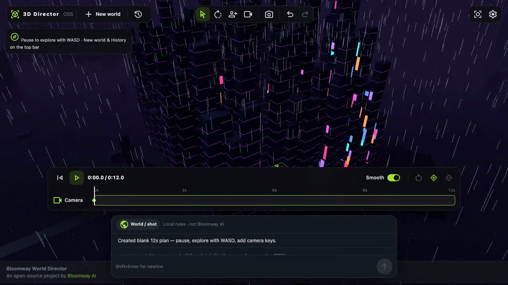
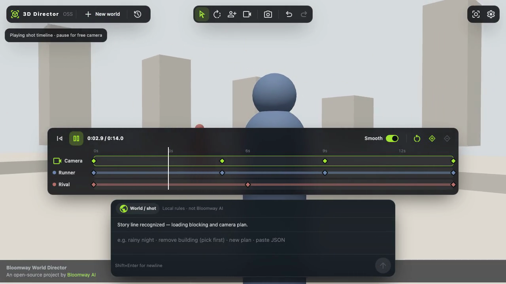

# Bloomway World Director

[English](README.en.md) · [中文](README.zh-CN.md) · [Melayu](README.ms.md) · [Indonesia](README.id.md) · [日本語](README.ja.md) · [한국어](README.ko.md) · [Español](README.es.md) · [**All languages**](README.md)

**Your words. Your world. Your camera.**

Build 3D worlds and direct camera moves for cinematic **previsualization** (low-poly blockout)—not a general-purpose AI video generation model. Turning previs into finished footage is an optional workflow on [Bloomway](https://bloomway.ai).

> **Bloomway open experiment:** build a world from one sentence, block shots in 3D previs, then bring them to the screen. An open toolkit for creators and researchers.  
> **Updates:** this repository is actively maintained; expect ongoing improvements.

**MIT commercial use** does not require registration or revenue sharing. Contact **info@bloomway.ai** only if you want collaboration—**not** a license condition. See [docs/commercial-use.md](docs/commercial-use.md).

---

## Three paths

| Path | What it is |
| ---- | ----------- |
| **1 — Open source (local)** | Run examples locally and understand text → 3D previs. Best for learning, teaching, and research. |
| **2 — Bloomway MCP (optional)** | Connect the same descriptions to hosted previs and generation—**optional**, not required to use this repo. |
| **3 — Advanced & teams** | Collaboration, commercial templates, and delivery on the [Bloomway platform](https://bloomway.ai). |

---

## Quick start

**Requirements:** Node.js ≥ 20, npm ≥ 10. No Bloomway account or API keys for the bundled example.

```bash
git clone https://github.com/bloomway-ai/bloomway-world-director.git
cd bloomway-world-director
npm install
npm run verify:example
npm run dev                  # Studio at http://localhost:5173/
```

Default Studio loads [`examples/edo-rainy-night`](examples/edo-rainy-night/) (checked-in JSON, not live cloud inference).

**Truth sources:** [docs/implementation-audit.md](docs/implementation-audit.md) · [docs/verification-log.md](docs/verification-log.md)

Optional: `npm run verify:studio-e2e`, `npm run record:demos`, `npm run capture:screenshots`.

---

## Screenshots

OSS Studio **v0.1** (English UI only). Home → one-line world → camera timeline.

| Home (presets & composer) | World from one line | Camera timeline |
| ------------------------- | ------------------- | ---------------- |
|  |  |  |

---

## See it in action

Recorded from **this repository’s** OSS Studio (not the full commercial Bloomway app).  
GitHub does not autoplay video in the README—**click a poster** to open the file, or use the links below.

<p align="center">
  <a href="media/demo-city-tour.mp4"></a>
  &nbsp;
  <a href="media/demo-drama.mp4"></a>
</p>

| Demo | One-line prompt | File |
| ---- | --------------- | ---- |
| City tour | `Snowy daytime Tokyo urban city` → explore with WASD | [demo-city-tour.mp4](media/demo-city-tour.mp4) |
| Street drama | `Rainy night — two rivals meet in the street` → play blocking | [demo-drama.mp4](media/demo-drama.mp4) |

Regenerate: `npm run record:demos`. Legacy: [demo.mp4](media/demo.mp4) · [Media notes](media/README.md)

---

## What runs locally

| Status | Capability |
| ------ | ---------- |
| **Verified** | `plan.json` + `world-ref.json`, `validatePrevisPlan`, `generatePrevisWorld`, `samplePrevisCamera` |
| **Verified** | V2 Director viewport + timeline (`verify:studio-e2e`); legacy blockout via `?legacy=1` |
| **Experimental** | Keyword/rule composer without cloud LLM |
| **Planned** | Full cloud Composer, MCP Director tools, more examples |

Natural-language “any sentence → plan” assistants are **hosted on Bloomway only** (not in this repo).

---

## Current limitations

1. Marketing lines describe product vision; the OSS example uses **checked-in JSON**.
2. Visual fidelity is **blockout** only—not Bloomway final renders.
3. Studio **UI is English only** in v0.1; see [docs/product-parity.md](docs/product-parity.md).
4. Local “one line → world” uses **rules and presets**, not full cloud NLU.

Details: [docs/implementation-audit.md](docs/implementation-audit.md) §6.

---

## Example scenes

| Example | Folder |
| ------- | ------ |
| Edo rainy night (default Studio load) | [`examples/edo-rainy-night`](examples/edo-rainy-night/) |
| Street confrontation | [`examples/street-drama`](examples/street-drama/) |
| Modern city street | [`examples/modern-city-street`](examples/modern-city-street/) |
| Mars research base | [`examples/mars-base`](examples/mars-base/) |

Community showcase: [`docs/gallery/README.md`](docs/gallery/README.md) · Discussions (when enabled).

## Roadmap
- MCP integration docs and tools
- Richer Studio (import, export UI)
- Studio UI translations (app chrome; README already multilingual)

---

## Optional Bloomway workflow

*Want to turn your previs into finished footage? Explore the connected workflow at [Bloomway](https://bloomway.ai).*

---

## Commercial use & branding

MIT — see [LICENSE](LICENSE). Copyright (c) 2026 Bloomway AI Inc. Demo media: [CC BY 4.0](media/README.md). Third-party notices: [docs/THIRD_PARTY_NOTICES.md](docs/THIRD_PARTY_NOTICES.md).

Trademarks: [TRADEMARKS.md](TRADEMARKS.md). Do not imply official endorsement.

---

## Contributing

[CONTRIBUTING.md](CONTRIBUTING.md) · [docs/ACCEPTANCE.md](docs/ACCEPTANCE.md)

*If this helps you explore a shot—or you want to follow what we build next—give the project a ⭐.*