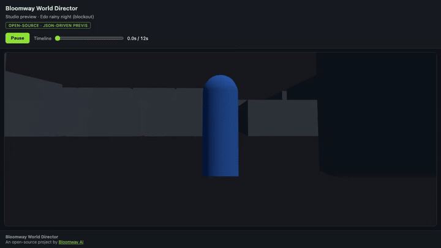

# Bloomway World Director

<p align="center">
  <a href="media/demo.mp4">
    
  </a>
  <br><sub><a href="media/demo.mp4">▶ OSS clip</a> · estructura canónica: <a href="README.md">README.md</a></sub>
</p>

[English](README.md) · [中文](README.zh-CN.md) · [Melayu](README.ms.md) · [Indonesia](README.id.md) · [日本語](README.ja.md) · [한국어](README.ko.md) · [Español](README.es.md)

**Your words. Your world. Your camera.**

Construye mundos 3D y dirige la cámara para **previsualización** cinematográfica (blockout de baja poli)—no es un modelo generalista de generación de video con IA. Llevar el previs a imagen final es un flujo opcional en [Bloomway](https://bloomway.ai).

> **Experimento abierto Bloomway:** construye un mundo con una frase, bloquea planos en previs 3D y llévalos a pantalla. Herramienta abierta para creadores e investigadores.  
> **Actualizaciones continuas:** este repositorio se mantiene activamente; habrá mejoras regulares.

**Uso comercial bajo MIT** sin registro, notificación ni reparto de ingresos. Contacta **info@bloomway.ai** solo si deseas colaborar—**no** es condición de licencia. Ver [docs/commercial-use.md](docs/commercial-use.md).

---

> **MCP:** no incluido en el repo (**planificado**) — [docs/mcp/README.md](docs/mcp/README.md). Demo en navegador: [docs/deploy/studio-hosting.md](docs/deploy/studio-hosting.md).

---

## Inicio rápido

**Probar en el navegador:** [Abrir OSS Studio](https://bloomway-ai.github.io/bloomway-world-director/) — blockout de baja poli + JSON del repo; [Vercel opcional](docs/deploy/studio-hosting.md). Sin NL alojado ni video final ([audit](docs/implementation-audit.md)).

**Requisitos (local):** Node.js ≥ 20, npm ≥ 10. Sin cuenta Bloomway ni claves API para el ejemplo incluido.

```bash
git clone https://github.com/bloomway-ai/bloomway-world-director.git
cd bloomway-world-director
npm install
npm run verify:example
npm run dev                  # Studio en http://localhost:5173/
```

El Studio carga por defecto [`examples/edo-rainy-night`](examples/edo-rainy-night/) (JSON en el repo, no inferencia en la nube en vivo).

**Fuentes de verdad:** [docs/implementation-audit.md](docs/implementation-audit.md) · [docs/verification-log.md](docs/verification-log.md)

Opcional: `npm run verify:studio-e2e`, `npm run record:demos`, `npm run capture:screenshots`.

---

## Capturas

| Inicio | Mundo en una línea | Línea de tiempo |
| ------ | ------------------ | --------------- |
|  |  |  |

---

## Ver en acción

Grabado desde el Studio OSS de **este repositorio**. Vista previa en bucle abajo — **▶ Full MP4** para el archivo completo.

<table>
  <tr>
    <td width="50%">
      <a href="https://github.com/bloomway-ai/bloomway-world-director/releases/download/v0.1.0/demo-city-tour.mp4">
        
      </a>
      <br><sub><a href="https://github.com/bloomway-ai/bloomway-world-director/releases/download/v0.1.0/demo-city-tour.mp4">▶ Full MP4</a></sub>
    </td>
    <td width="50%">
      <a href="https://github.com/bloomway-ai/bloomway-world-director/releases/download/v0.1.0/demo-drama.mp4">
        
      </a>
      <br><sub><a href="https://github.com/bloomway-ai/bloomway-world-director/releases/download/v0.1.0/demo-drama.mp4">▶ Full MP4</a></sub>
    </td>
  </tr>
</table>

| Demo | Frase de una línea | Archivo |
| ---- | ------------------ | ------- |
| Recorrido urbano | `Snowy daytime Tokyo urban city` → explorar con WASD | [demo-city-tour.mp4](media/demo-city-tour.mp4) |
| Drama callejero | `Rainy night — two rivals meet in the street` → reproducir blocking | [demo-drama.mp4](media/demo-drama.mp4) |

Regenerar: `npm run record:demos`. Legado: [demo.mp4](media/demo.mp4) · [Notas de media](media/README.md)

Producto completo: [bloomway.ai](https://bloomway.ai)

---

## Qué corre en local

| Estado | Capacidad |
| ------ | --------- |
| **Verificado** | `plan.json` + `world-ref.json`, `validatePrevisPlan`, `generatePrevisWorld`, `samplePrevisCamera` |
| **Verificado** | Viewport Director V2 + línea de tiempo (`verify:studio-e2e`); blockout legado con `?legacy=1` |
| **Experimental** | Composer por reglas/palabras clave sin LLM en la nube |
| **Planificado** | Composer cloud completo, herramientas MCP Director, más ejemplos |

Los asistentes de lenguaje natural «cualquier frase → plan» están **solo en Bloomway alojado** (no en este repo).

---

## Limitaciones actuales

1. El mensaje de marketing describe la visión del producto; el ejemplo OSS usa **JSON fijado en el repo**.  
2. La fidelidad visual es solo **blockout**—no renders finales de Bloomway.  
3. La **UI del Studio solo en inglés** en v0.1; ver [docs/product-parity.md](docs/product-parity.md).  
4. «Una línea → mundo» local usa **reglas y presets**, no NLU cloud completo.

Detalles: [docs/implementation-audit.md](docs/implementation-audit.md) §6.

---

## Hoja de ruta

- Más ejemplos (`modern-city-street`, `mars-base`)
- Documentación y herramientas de integración MCP
- Studio más rico (importar/exportar UI)
- Traducciones de la UI del Studio (cromo de la app; el README ya es multilingüe)

---

## Flujo Bloomway opcional

*¿Quieres convertir el previs en imagen final? Explora el flujo conectado en [Bloomway](https://bloomway.ai).*

---

## Uso comercial y marca

MIT — ver [LICENSE](LICENSE). Copyright (c) 2026 Bloomway AI Inc. Medios demo: [CC BY 4.0](media/README.md). Avisos de terceros: [docs/THIRD_PARTY_NOTICES.md](docs/THIRD_PARTY_NOTICES.md).

Marcas: [TRADEMARKS.md](TRADEMARKS.md). No implique respaldo oficial.

---

## Contribuir

[CONTRIBUTING.md](CONTRIBUTING.md) · [docs/ACCEPTANCE.md](docs/ACCEPTANCE.md)

*Si te ayuda a explorar un plano o quieres seguir lo que construimos, deja una ⭐.*