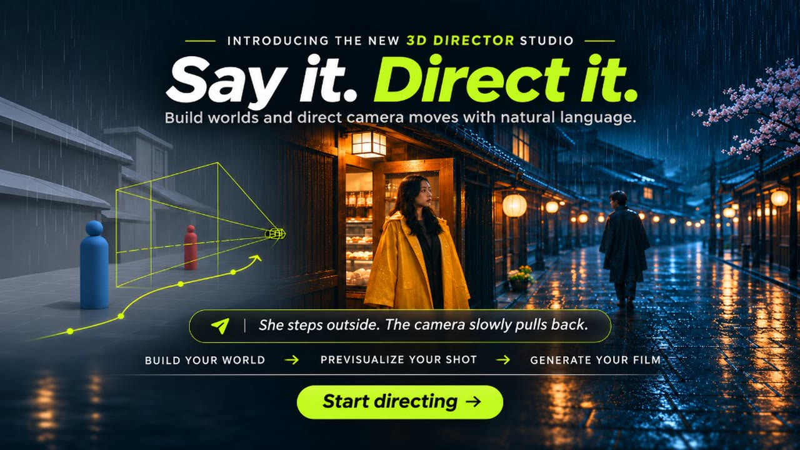

# Bloomway World Director

**Build a world. Block a scene. Rehearse the camera.**

Studio pravis 3D sumber terbuka untuk perencanaan adegan, blocking karakter, dan gerakan kamera.

[English](README.md) · [中文](README.zh-CN.md) · [Melayu](README.ms.md) · [日本語](README.ja.md) · [한국어](README.ko.md) · [Español](README.es.md)

<p align="center">
  <a href="https://bloomway-ai.github.io/bloomway-world-director/watch-full-demo.html">
    
  </a>
  <br><sub><a href="https://bloomway-ai.github.io/bloomway-world-director/watch-full-demo.html">▶ Play</a> · 63s · <a href="https://github.com/bloomway-ai/bloomway-world-director/releases/download/v0.1.0/final_v2_cold_open.mp4">1080p</a></sub>
</p>

*Film visi 63s — alur produk Bloomway; bukan rekaman OSS Studio di bawah.*

Repositori ini menyediakan alat pravis 3D open source. Generasi footage akhir adalah alur [Bloomway](https://bloomway.ai) terpisah.

<p align="center"><a href="https://bloomway-ai.github.io/bloomway-world-director/"></a></p>
<p align="center"><a href="#run-locally"></a></p>

Gratis · MIT · tanpa registrasi (**hanya OSS Studio**).

---

## Try it

**[Buka Studio di browser](https://bloomway-ai.github.io/bloomway-world-director/)** — preset / kata kunci / putar timeline. Bukan LLM kalimat bebas.

### Run locally

```bash
git clone https://github.com/bloomway-ai/bloomway-world-director.git
cd bloomway-world-director && npm install && npm run dev
```

---

## See the open-source Studio in action

<p align="center"><a href="https://bloomway-ai.github.io/bloomway-world-director/"></a></p>
<p align="center"><a href="https://bloomway-ai.github.io/bloomway-world-director/?example=1&autoplay=1"></a></p>

<table>
  <tr>
    <td width="50%"><a href="https://github.com/bloomway-ai/bloomway-world-director/releases/download/v0.1.0/demo-city-tour.mp4"></a></td>
    <td width="50%"><a href="https://github.com/bloomway-ai/bloomway-world-director/releases/download/v0.1.0/demo-drama.mp4"></a></td>
  </tr>
</table>

[README.md](README.md) · **info@bloomway.ai** · [MIT](LICENSE)