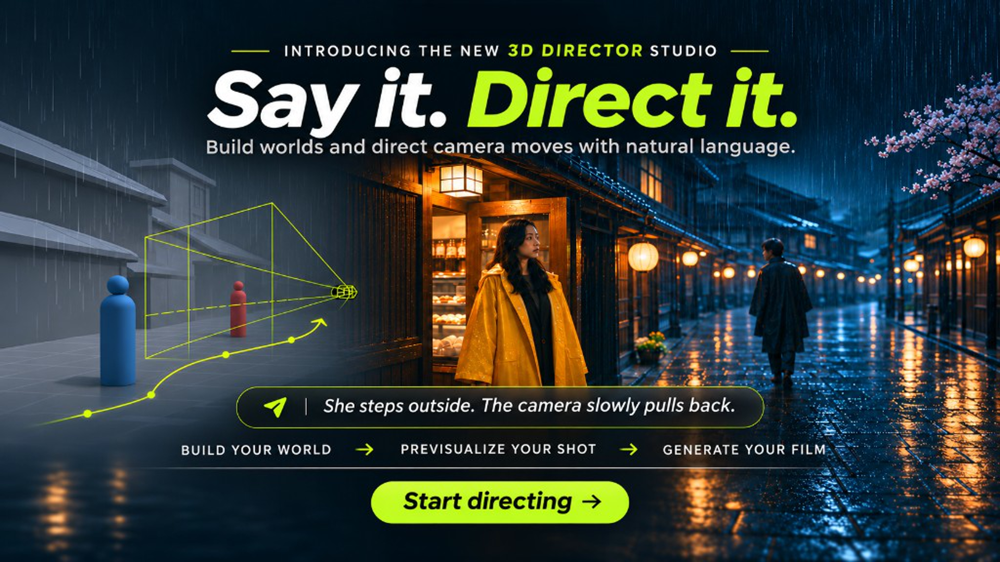

# Bloomway World Director

**Build a world. Block a scene. Rehearse the camera.**

シーン設計・人物ブロッキング・カメラ運動のためのオープンソース 3D プレビズ Studio。

[English](README.md) · [中文](README.zh-CN.md) · [Melayu](README.ms.md) · [Indonesia](README.id.md) · [한국어](README.ko.md) · [Español](README.es.md)

<p align="center">
  <a href="https://bloomway-ai.github.io/bloomway-world-director/watch-full-demo.html">
    
  </a>
  <br><sub><a href="https://bloomway-ai.github.io/bloomway-world-director/watch-full-demo.html">▶ Play</a> · 63s · <a href="https://github.com/bloomway-ai/bloomway-world-director/releases/download/v0.1.0/final_v2_cold_open.mp4">1080p</a></sub>
</p>

*63 秒のビジョン映像は Bloomway 製品の流れ。下記 OSS ブロックアウト Studio の録画ではありません。*

本リポジトリはオープンソースの 3D プレビズツールです。完成映像生成は別の [Bloomway](https://bloomway.ai) ワークフローです。

**[ブラウザで試す](https://bloomway-ai.github.io/bloomway-world-director/)** · [ローカル実行](#run-locally)

無料 · MIT · 登録不要（**OSS Studio のみ** — クラウド渲染クレジットは含みません）。

---

## 試す

### ブラウザ

**[オンライン Studio を開く](https://bloomway-ai.github.io/bloomway-world-director/)**

1. または [`?example=1&autoplay=1`](https://bloomway-ai.github.io/bloomway-world-director/?example=1&autoplay=1) で Edo 例。  
2. **プリセット** または **短いフレーズ**（キーワード規則 — 任意 NL 生成ではありません）。  
3. タイムライン **再生** でカメラとブロッキングを確認。

API Key 不要 · デスクトップブラウザ推奨 · フッター **GitHub** で本リポジトリへ。

### Run locally

Node.js **≥ 20** · npm **≥ 10**

```bash
git clone https://github.com/bloomway-ai/bloomway-world-director.git
cd bloomway-world-director && npm install && npm run dev
```

**http://localhost:5173/** — 既定 [`examples/edo-rainy-night`](examples/edo-rainy-night/)

---

## See the open-source Studio in action

本リポジトリ OSS Studio の実画面（ローポリ）。ループは無音 · 完成映像ではありません。

<p align="center">
  <a href="https://bloomway-ai.github.io/bloomway-world-director/">
    
  </a>
</p>

<p align="center">
  <a href="https://bloomway-ai.github.io/bloomway-world-director/?example=1&autoplay=1">
    
  </a>
</p>

<table>
  <tr>
    <td width="50%"><a href="https://github.com/bloomway-ai/bloomway-world-director/releases/download/v0.1.0/demo-city-tour.mp4"></a></td>
    <td width="50%"><a href="https://github.com/bloomway-ai/bloomway-world-director/releases/download/v0.1.0/demo-drama.mp4"></a></td>
  </tr>
</table>

オフライン規則とプリセット。[Release v0.1.0](https://github.com/bloomway-ai/bloomway-world-director/releases/tag/v0.1.0) · [implementation-audit](docs/implementation-audit.md) · **info@bloomway.ai** · [MIT](LICENSE)