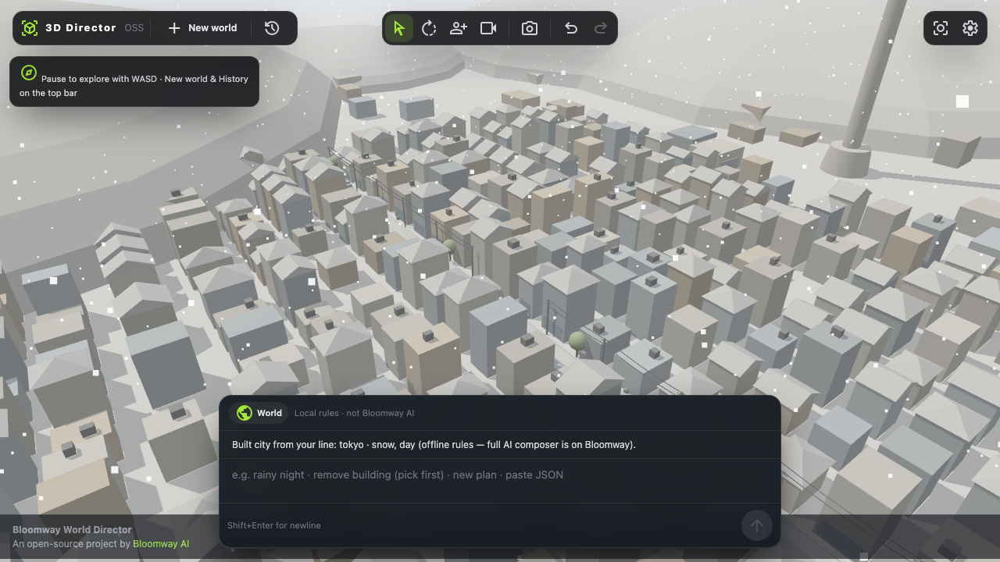

# Bloomway World Director

<p align="center">
  <a href="https://github.com/bloomway-ai/bloomway-world-director/releases/download/v0.1.0/promo-cold-open.mp4">
    
  </a>
  <br><sub><a href="https://github.com/bloomway-ai/bloomway-world-director/releases/download/v0.1.0/promo-cold-open.mp4">▶ Full video (63s)</a></sub>
</p>

[English](README.en.md) · [中文](README.zh-CN.md) · [Melayu](README.ms.md) · [Indonesia](README.id.md) · [日本語](README.ja.md) · [한국어](README.ko.md) · [Español](README.es.md) · [**모든 언어**](README.md)

**Your words. Your world. Your camera.**

3D 세계를 만들고 카메라를 연출하는 영화 **프리비즈**(저폴리 블록아웃)용 도구입니다—범용 AI 영상 생성 모델이 아닙니다. 완성 영상으로 이어지는 것은 [Bloomway](https://bloomway.ai)의 선택적 워크플로입니다.

> **Bloomway 오픈 실험:** 한 문장으로 세계를 짓고, 3D 프리비즈에서 인물과 카메라를 배치한 뒤 샷으로 연결합니다. 크리에이터와 연구자를 위한 오픈 툴킷.  
> **지속 업데이트:** 이 저장소는 활발히 유지보수되며 앞으로도 개선이 이어집니다.

**MIT 상업 이용**에 등록·신고·수익 분배가 필요 없습니다. **info@bloomway.ai**는 자발적 협업 연락용이며 **라이선스 조건이 아닙니다**. [docs/commercial-use.md](docs/commercial-use.md) 참고.

---

## 세 가지 경로

| 경로 | 설명 |
| ---- | ---- |
| **경로 1 — 오픈소스(로컬)** | 예제를 로컬에서 실행하며 텍스트 → 3D 프리비즈를 이해합니다. 학습·교육·연구에 적합합니다. |
| **경로 2 — Bloomway MCP(선택)** | 같은 설명을 호스팅 프리비즈·생성에 연결—**선택 사항**이며 이 저장소 사용에 필수는 아닙니다. |
| **경로 3 — 고급·팀** | 협업, 상용 템플릿, 제작 지원은 [Bloomway 플랫폼](https://bloomway.ai). |

샷 예시는 Discussions 공유를 환영합니다.

---

## 빠른 시작

**요구 사항:** Node.js ≥ 20, npm ≥ 10. 번들 예제에 Bloomway 계정·API 키 불필요.

```bash
git clone https://github.com/bloomway-ai/bloomway-world-director.git
cd bloomway-world-director
npm install
npm run verify:example
npm run dev                  # Studio: http://localhost:5173/
```

기본 Studio는 [`examples/edo-rainy-night`](examples/edo-rainy-night/)를 로드합니다(저장소 JSON, 라이브 클라우드 추론 아님).

**구현 기준 문서:** [docs/implementation-audit.md](docs/implementation-audit.md) · [docs/verification-log.md](docs/verification-log.md)

선택: `npm run verify:studio-e2e`, `npm run record:demos`, `npm run capture:screenshots`.

---

## 스크린샷

| 홈 | 한 줄 세계 | 카메라 타임라인 |
| -- | ---------- | --------------- |
|  |  |  |

---

## 데모

**이 저장소** OSS Studio 녹화. 아래는 루프 미리보기 — **▶ Full MP4** 로 원본.

<table>
  <tr>
    <td width="50%">
      <a href="https://github.com/bloomway-ai/bloomway-world-director/releases/download/v0.1.0/demo-city-tour.mp4">
        
      </a>
      <br><sub><a href="https://github.com/bloomway-ai/bloomway-world-director/releases/download/v0.1.0/demo-city-tour.mp4">▶ Full MP4</a></sub>
    </td>
    <td width="50%">
      <a href="https://github.com/bloomway-ai/bloomway-world-director/releases/download/v0.1.0/demo-drama.mp4">
        
      </a>
      <br><sub><a href="https://github.com/bloomway-ai/bloomway-world-director/releases/download/v0.1.0/demo-drama.mp4">▶ Full MP4</a></sub>
    </td>
  </tr>
</table>

| 데모 | 한 줄 프롬프트 | 파일 |
| ---- | -------------- | ---- |
| 도시 투어 | `Snowy daytime Tokyo urban city` → WASD 탐색 | [demo-city-tour.mp4](media/demo-city-tour.mp4) |
| 거리 드라마 | `Rainy night — two rivals meet in the street` → 타임라인 재생 | [demo-drama.mp4](media/demo-drama.mp4) |

재생성: `npm run record:demos`. 레거시: [demo.mp4](media/demo.mp4) · [미디어 안내](media/README.md)

전체 제품: [bloomway.ai](https://bloomway.ai)

---

## 로컬에서 동작하는 것

| 상태 | 기능 |
| ---- | ---- |
| **검증됨** | `plan.json` + `world-ref.json`, `validatePrevisPlan`, `generatePrevisWorld`, `samplePrevisCamera` |
| **검증됨** | V2 디렉터 뷰포트 + 타임라인(`verify:studio-e2e`); `?legacy=1` 레거시 블록아웃 |
| **실험적** | 클라우드 LLM 없는 키워드·규칙 Composer |
| **계획** | 전체 클라우드 Composer, MCP Director 도구, 추가 예제 |

자연어 «어떤 문장이든 → 플랜» 어시스턴트는 **Bloomway 호스팅에만** 존재합니다.

---

## 현재 한계

1. 마케팅 문구는 제품 비전을 설명하나 OSS 예제는 **체크인된 JSON**을 사용합니다.  
2. 시각 품질은 **블록아웃**뿐—Bloomway 최종 렌더가 아닙니다.  
3. Studio **UI는 v0.1에서 영어만**; [docs/product-parity.md](docs/product-parity.md) 참고.  
4. 로컬 «한 줄 → 세계»는 **규칙과 프리셋**이며 전체 클라우드 NLU가 아닙니다.

자세히: [docs/implementation-audit.md](docs/implementation-audit.md) §6.

---

## 로드맵

- 추가 예제(`modern-city-street`, `mars-base`)
- MCP 통합 문서·도구
- Studio 강화(가져오기·내보내기 UI)
- Studio UI 다국어(앱 chrome; README는 이미 7개 언어)

---

## 선택적 Bloomway 워크플로

*프리비즈를 완성 영상으로 이어가고 싶으신가요? [Bloomway](https://bloomway.ai)에서 연결 워크플로를 확인하세요.*

---

## 상업 이용 및 브랜드

MIT — [LICENSE](LICENSE). Copyright (c) 2026 Bloomway AI Inc. 데모 미디어: [CC BY 4.0](media/README.md). 타사 고지: [docs/THIRD_PARTY_NOTICES.md](docs/THIRD_PARTY_NOTICES.md).

상표: [TRADEMARKS.md](TRADEMARKS.md). 공식 후원을 암시하지 마세요.

---

## 기여

[CONTRIBUTING.md](CONTRIBUTING.md) · [docs/ACCEPTANCE.md](docs/ACCEPTANCE.md)

*샷 탐색에 도움이 되었거나 다음 업데이트를 따라가고 싶다면 ⭐ 부탁드립니다.*