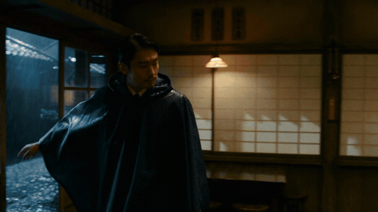

# Bloomway World Director

**Build a world. Block a scene. Rehearse the camera.**

An MIT-licensed **3D previsualization toolkit** with procedural worlds, character blocking, and camera timelines — low-poly **blockout**, not final footage or a general AI video model.

[中文](README.zh-CN.md) · [English details](README.en.md) · [Melayu](README.ms.md) · [Indonesia](README.id.md) · [日本語](README.ja.md) · [한국어](README.ko.md) · [Español](README.es.md)

[](LICENSE) [](https://github.com/bloomway-ai/bloomway-world-director/actions/workflows/verify.yml) [](https://github.com/bloomway-ai/bloomway-world-director/releases/tag/v0.1.0)

*Your words. Your world. Your camera.* — tagline for the Bloomway product line; in **this repo**, text entry is **offline rules + presets** (see [Natural language](#natural-language-local-only) below).

**MIT commercial use:** free under [LICENSE](LICENSE) — no registration, revenue share, or mandatory credit roll. Details: [docs/commercial-use.md](docs/commercial-use.md).

---

## Introduction and demo

**What this GIF shows (real OSS Studio v0.1, ~15s, silent):** load bundled **Edo rainy night** → timeline **Play** → camera + blocking advance. No cloud login.  
*Recording is real-time screen capture (not sped up).*

<p align="center">
  <a href="media/demo.mp4">
    
  </a>
  <br><sub>▶ <a href="media/demo.mp4">Full clip (repo)</a> · <a href="https://github.com/bloomway-ai/bloomway-world-director/releases/download/v0.1.0/demo-city-tour.mp4">City tour</a> · <a href="https://github.com/bloomway-ai/bloomway-world-director/releases/download/v0.1.0/demo-drama.mp4">Street drama</a></sub>
</p>

| Step in the UI | What happens |
| -------------- | ------------- |
| Open Studio | Home with world **presets** + **composer** (English UI) |
| `?example=1` or default flow | Loads [`examples/edo-rainy-night`](examples/edo-rainy-night/) `plan.json` |
| Press **Play** on timeline | Camera samples keys; capsules follow blocking |
| Type in composer | **Keyword rules** (rain, night, Tokyo, “two rivals…”) — not cloud LLM |

More loops (supplementary): [`media/demo-city-tour.gif`](media/demo-city-tour.gif) · [`media/demo-drama.gif`](media/demo-drama.gif).

If this helps you plan a shot—or you want to follow what we ship—give the project a ⭐.

---

## Try it

### Local (recommended)

```bash
git clone https://github.com/bloomway-ai/bloomway-world-director.git
cd bloomway-world-director
npm install
npm run dev
```

Open **http://localhost:5173/** — or **http://localhost:5173/?example=1&autoplay=1** to jump straight into the Edo example.

### Browser (OSS Studio — after deploy)

Static hosting is configured ([`docs/deploy/studio-hosting.md`](docs/deploy/studio-hosting.md)). **Intended URL:** `https://bloomway-ai.github.io/bloomway-world-director/`

| Status (2026-11-14) | Note |
| ------------------- | ---- |
| Workflow on `main` | `.github/workflows/deploy-studio-pages.yml` |
| **Live check** | Returns **404** until **Settings → Pages → Source: GitHub Actions** is enabled and a deploy succeeds |
| Vercel (optional) | Root [`vercel.json`](vercel.json) — separate URL, same static build |

**Do not** treat [bloomway.ai](https://bloomway.ai) as the OSS Studio — it is the **optional hosted product** (account / billing may apply).

---

## Quick start

| Requirement | Value |
| ----------- | ----- |
| Node.js | **≥ 20** |
| npm | **≥ 10** |
| Bloomway account | **Not required** for bundled examples |
| API keys / network | **Not required** for default blockout path |

```bash
git clone https://github.com/bloomway-ai/bloomway-world-director.git
cd bloomway-world-director
npm install
npm run dev
```

**First session**

1. Browser opens **http://localhost:5173/** (home).
2. Click a **preset** (e.g. Edo) *or* open `/?example=1&autoplay=1` for [`edo-rainy-night`](examples/edo-rainy-night/).
3. Use **Play** on the timeline to rehearse camera + blocking.
4. In the composer, try: `rainy night`, `snowy daytime Tokyo urban city`, or `two rivals meet in the street` — see [Natural language](#natural-language-local-only).

**Default scene:** [`examples/edo-rainy-night`](examples/edo-rainy-night/) (`plan.json` + `world-ref.json` in git).

Maintainers: validation & recordings live in [docs/verification-log.md](docs/verification-log.md) (`verify:example`, `verify:examples`, `verify:studio-e2e` — **not** required for visitors).

---

## What you can do

| You can | You cannot (in this repo) |
| ------- | ------------------------- |
| Build a procedural **street / city / themed** layout from presets + refs | Unlimited NLU “any sentence → full storyboard” |
| Place and move **stand-in characters** (capsule blocking) | Replace blockout with AI final renders |
| Preview **camera paths** and shot timing on a timeline | Free cloud generation compute |
| Edit plans as JSON or via rule-based composer phrases | Full commercial Director UI parity |

Truth table: [docs/implementation-audit.md](docs/implementation-audit.md) (updated **2026-11-14**).

---

## Example scenes

| Example | Visitor-friendly | Details |
| ------- | ---------------- | ------- |
| **Edo rainy night** | **Start here** | Default `?example=1` · [folder](examples/edo-rainy-night/) |
| **Street drama** | Composer + demo video | [folder](examples/street-drama/) |
| **Modern city street** | JSON + presets | [folder](examples/modern-city-street/) — no home tile yet |
| **Mars base** | JSON + **Mars** preset | [folder](examples/mars-base/) — no home tile yet |

Full matrix: [docs/examples/STATUS.md](docs/examples/STATUS.md).

### Official examples (gallery)

| Clip | Source | License |
| ---- | ------ | ------- |
| Edo autoplay (~15s) | [`media/demo.mp4`](media/demo.mp4) | CC BY 4.0 |
| City tour (~20s) | [Release MP4](https://github.com/bloomway-ai/bloomway-world-director/releases/download/v0.1.0/demo-city-tour.mp4) | CC BY 4.0 |
| Street drama (~22s) | [Release MP4](https://github.com/bloomway-ai/bloomway-world-director/releases/download/v0.1.0/demo-drama.mp4) | CC BY 4.0 |

Community slots: [docs/gallery/README.md](docs/gallery/README.md) (empty until real submissions).

---

## Current limitations

1. **Visual fidelity** — low-poly blockout only; not Bloomway final renders.
2. **Studio UI** — English chrome in v0.1; README is multilingual (links at top).
3. **Natural language** — see below; not open-ended LLM in OSS.
4. **Examples** — all four validate; two are one-click friendly (Edo, street drama).
5. **WebGL** — desktop browser recommended; mobile WebGL varies.

### Natural language (local only)

The composer (`apps/studio`) supports **short phrases** mapped to **presets** and **world patches** (weather, time of day, style keywords) and a few **drama loaders** that fetch bundled `plan.json`. It does **not** call Bloomway servers. Full NL planning stays on the hosted product.

---

## From previs to finished footage

The 63s **brand film** shows a Bloomway **product vision** (world → screen). It is **not** a substitute for trying the OSS blockout Studio.

<p align="center">
  <a href="https://github.com/bloomway-ai/bloomway-world-director/releases/download/v0.1.0/final_v2_cold_open.mp4">
    
  </a>
  <br><sub>Product montage (loop ~12s) · <a href="https://github.com/bloomway-ai/bloomway-world-director/releases/download/v0.1.0/final_v2_cold_open.mp4">▶ Full film (~63s, audio)</a> — Release asset filename <code>final_v2_cold_open.mp4</code></sub>
</p>

*Want to turn your previs into finished footage? Explore the **optional** workflow at [Bloomway](https://bloomway.ai) (separate terms; may require account).*

---

## Community and contributing

- **Discussions:** https://github.com/bloomway-ai/bloomway-world-director/discussions  
- **Challenge (draft post):** [One scene. Three camera moves.](docs/community/challenge-one-scene-three-moves.md)  
- **Contributing:** [CONTRIBUTING.md](CONTRIBUTING.md) · acceptance notes [docs/ACCEPTANCE.md](docs/ACCEPTANCE.md)

Contact **info@bloomway.ai** only for voluntary collaboration — not a license requirement.

---

## Roadmap

| Item | Status |
| ---- | ------ |
| Director **MCP** tools in this repo | **Planned** — see [docs/mcp/README.md](docs/mcp/README.md) |
| GitHub Pages OSS Studio | **Ready to enable** — [docs/deploy/studio-hosting.md](docs/deploy/studio-hosting.md) |
| One-click Studio tiles for all four examples | **Planned** |
| Studio UI translations | **Planned** |
| Deeper import/export UI | **Planned** |

---

## License and acknowledgments

- **Source:** [MIT](LICENSE) — Copyright (c) Bloomway AI Inc.  
- **Demo media:** [CC BY 4.0](media/LICENSE) — [media/README.md](media/README.md)  
- **Trademarks:** [TRADEMARKS.md](TRADEMARKS.md)  
- **Third-party:** [docs/THIRD_PARTY_NOTICES.md](docs/THIRD_PARTY_NOTICES.md) · [docs/THIRD_PARTY_LICENSES.md](docs/THIRD_PARTY_LICENSES.md)

---

## Maintainer index

| Topic | Doc |
| ----- | --- |
| Implementation audit | [docs/implementation-audit.md](docs/implementation-audit.md) |
| Verification log | [docs/verification-log.md](docs/verification-log.md) |
| Release notes draft | [docs/RELEASE_NOTES_v0.1.0_DRAFT.md](docs/RELEASE_NOTES_v0.1.0_DRAFT.md) |
| Video / GIF URLs | [docs/promo/VIDEO_URLS.md](docs/promo/VIDEO_URLS.md) |
| GitHub About / topics | [docs/github/ABOUT.md](docs/github/ABOUT.md) |