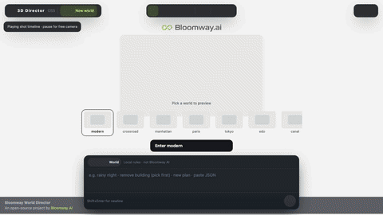

# Bloomway World Director

**Build a world. Block a scene. Rehearse the camera.**

An open-source 3D previs studio for planning scenes, character blocking, and camera movement.

[中文](README.zh-CN.md) · [Melayu](README.ms.md) · [Indonesia](README.id.md) · [日本語](README.ja.md) · [한국어](README.ko.md) · [Español](README.es.md)

<p align="center">
  <a href="https://bloomway-ai.github.io/bloomway-world-director/watch-full-demo.html">
    
  </a>
  <br><sub>
    <strong><a href="https://bloomway-ai.github.io/bloomway-world-director/watch-full-demo.html">▶ PLAY FULL DEMO</a></strong>
    · 63s · with audio · 1280p (~8&nbsp;MB)
    · <a href="https://github.com/bloomway-ai/bloomway-world-director/releases/download/v0.1.0/final_v2_cold_open.mp4">1080p download</a>
  </sub>
</p>

https://github.com/user-attachments/assets/c9382f04-355c-4c05-ac11-c86aab355fa0

*63s vision film — world → screen on the Bloomway product. Not a recording of the OSS blockout Studio below.*

This repository provides the open-source 3D previs tools. Final footage generation is a separate [Bloomway](https://bloomway.ai) workflow.

<p align="center">
  <a href="https://bloomway-ai.github.io/bloomway-world-director/">
    
  </a>
</p>
<p align="center">
  <a href="#run-locally">
    
  </a>
</p>

Free to use · MIT licensed · No sign-up required *(OSS Studio only — not cloud render credits).*

---

## Try it

### Try in browser

Use the green **TRY IN BROWSER** button above, or [`?example=1&autoplay=1`](https://bloomway-ai.github.io/bloomway-world-director/?example=1&autoplay=1) for bundled Edo blocking.

1. Choose a **preset** or type a **short phrase** (keyword rules — e.g. `rainy night`, `two rivals meet in the street`).
2. Press **Play** on the timeline to rehearse camera paths and blocking.

No sign-up or API key · desktop browser recommended · footer **GitHub** returns to this repo.

### Run locally

Node.js **≥ 20** · npm **≥ 10** · no Bloomway account or API keys for bundled examples.

```bash
git clone https://github.com/bloomway-ai/bloomway-world-director.git
cd bloomway-world-director
npm install
npm run dev
```

Open **http://localhost:5173/** — same flow as the browser Studio. Default scene: [`examples/edo-rainy-night`](examples/edo-rainy-night/).

---

## See the open-source Studio in action

Real screen captures from **this repo’s** OSS Studio (low-poly blockout). Silent loops · not final footage.

<p align="center">
  <a href="https://bloomway-ai.github.io/bloomway-world-director/">
    
  </a>
</p>

<p align="center">
  <a href="https://bloomway-ai.github.io/bloomway-world-director/?example=1&autoplay=1">
    
  </a>
  <br><sub>Presets/keywords → blockout scene → **Play** on timeline (street drama clip)</sub>
</p>

<table>
  <tr>
    <td width="50%">
      <a href="https://github.com/bloomway-ai/bloomway-world-director/releases/download/v0.1.0/demo-city-tour.mp4">
        
      </a>
      <br><sub><code>Snowy daytime Tokyo urban city</code> → explore blockout</sub>
    </td>
    <td width="50%">
      <a href="https://github.com/bloomway-ai/bloomway-world-director/releases/download/v0.1.0/demo-drama.mp4">
        
      </a>
      <br><sub>Keyword load → blocking + timeline</sub>
    </td>
  </tr>
</table>

Text input uses **offline rules and presets**, not open-ended natural-language generation. Full MP4s: [Release v0.1.0](https://github.com/bloomway-ai/bloomway-world-director/releases/tag/v0.1.0).

If this helps you plan a shot—or you want to follow what we ship—give the project a ⭐.

---

## What you can do

- Build **street / city / themed** layouts from presets and `world-ref.json`
- **Block characters** (stand-in capsules) and preview motion on a timeline
- **Rehearse camera** paths and shot timing
- Edit plans as JSON or short local keyword phrases

| In this OSS repo | Not included here |
| ---------------- | ----------------- |
| Low-poly **blockout** previs | General **AI video** model or free cloud render |
| Offline presets + keyword text | Hosted LLM “any sentence → plan” |

Details: [docs/implementation-audit.md](docs/implementation-audit.md) · commercial use: [docs/commercial-use.md](docs/commercial-use.md) · [MIT](LICENSE).

---

## Example scenes

| Example | Notes |
| ------- | ----- |
| [**Edo rainy night**](examples/edo-rainy-night/) | Default `?example=1` |
| [**Street drama**](examples/street-drama/) | Pairs with demo above |
| Modern city / Mars | JSON + presets — [docs/examples/STATUS.md](docs/examples/STATUS.md) |

---

## Current limitations

Blockout fidelity only · English Studio UI in v0.1 · desktop WebGL recommended · text field = keyword rules, not cloud LLM.

---

## Community and contributing

**Share your first shot in [Discussions](https://github.com/bloomway-ai/bloomway-world-director/discussions).** · [CONTRIBUTING.md](CONTRIBUTING.md) · optional **info@bloomway.ai**

---

## Roadmap

Director **MCP** and Studio i18n: **Planned** — [docs/mcp/README.md](docs/mcp/README.md).

---

## License

[MIT](LICENSE) · demo media [CC BY 4.0](media/LICENSE) · [TRADEMARKS.md](TRADEMARKS.md)

[](https://github.com/bloomway-ai/bloomway-world-director/actions/workflows/verify.yml) [](https://github.com/bloomway-ai/bloomway-world-director/releases/tag/v0.1.0)