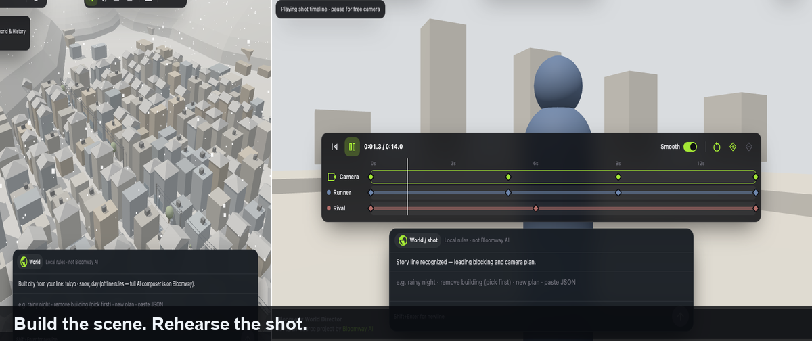
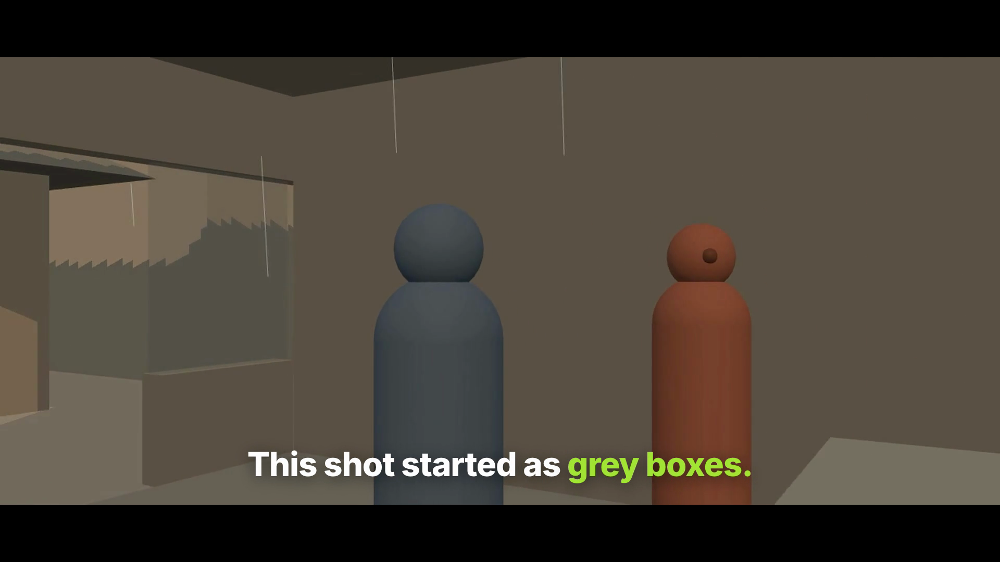

# Bloomway World Director

**Build a world. Block a scene. Rehearse the camera.**

An open-source 3D previs studio for exploring scenes, character blocking, and camera movement.

Free to use · MIT licensed · No sign-up required

[中文](README.zh-CN.md) · [Melayu](README.ms.md) · [Indonesia](README.id.md) · [日本語](README.ja.md) · [한국어](README.ko.md) · [Español](README.es.md)

[](LICENSE) [](https://github.com/bloomway-ai/bloomway-world-director/actions/workflows/verify.yml) [](https://github.com/bloomway-ai/bloomway-world-director/releases/tag/v0.1.0)

**[Try in browser](https://bloomway-ai.github.io/bloomway-world-director/)** · [Run locally](#run-locally) · [Watch demos](#watch-demos)

No sign-up or API key required. Desktop browser recommended.

<p align="center">
  <a href="https://bloomway-ai.github.io/bloomway-world-director/?example=1&autoplay=1">
    
  </a>
  <br><sub>Input → blockout scene → <strong>Play</strong> on the timeline (street drama demo)</sub>
</p>

---

## Try it

### Try in browser

<p align="center">
  <a href="https://bloomway-ai.github.io/bloomway-world-director/">
    
  </a>
</p>

**Live —** [Open the browser Studio](https://bloomway-ai.github.io/bloomway-world-director/)

1. Open the link — or [`?example=1&autoplay=1`](https://bloomway-ai.github.io/bloomway-world-director/?example=1&autoplay=1) to start with Edo blocking.
2. Pick a **preset** or type a short line (e.g. `two rivals meet in the street`).
3. Press **Play** on the timeline to rehearse camera + blocking.

Footer **GitHub** link returns to this repo. Same OSS app — not the full [Bloomway](https://bloomway.ai) product.

### Run locally

| Node.js **≥ 20** · npm **≥ 10** · No Bloomway account or API keys |

```bash
git clone https://github.com/bloomway-ai/bloomway-world-director.git
cd bloomway-world-director
npm install
npm run dev
```

Open **http://localhost:5173/** — same flow as browser. Default: [`examples/edo-rainy-night`](examples/edo-rainy-night/).

---

## Watch demos

Two longer loops (~10s). [▶ Full MP4s on Release](https://github.com/bloomway-ai/bloomway-world-director/releases/tag/v0.1.0).

<table>
  <tr>
    <td width="50%">
      <a href="https://github.com/bloomway-ai/bloomway-world-director/releases/download/v0.1.0/demo-city-tour.mp4">
        
      </a>
      <br><sub><code>Snowy daytime Tokyo urban city</code></sub>
    </td>
    <td width="50%">
      <a href="https://github.com/bloomway-ai/bloomway-world-director/releases/download/v0.1.0/demo-drama.mp4">
        
      </a>
      <br><sub>Street drama + timeline</sub>
    </td>
  </tr>
</table>

If this helps you plan a shot—or you want to follow what we ship—give the project a ⭐.

---

## What you can do

- Build a **street / city / themed** layout from presets and world refs
- Place **stand-in characters** and blocking paths
- Preview **camera paths** and timing on a timeline
- Short **local text rules** only — not cloud LLM or final renders

| In this OSS repo | Not included here |
| ---------------- | ----------------- |
| Low-poly **blockout** previs | General **AI video** model / free render credits |
| Offline presets + keywords | “Any sentence → full storyboard” (hosted product) |

Commercial use: [MIT](LICENSE) · [docs/commercial-use.md](docs/commercial-use.md) · boundaries: [docs/implementation-audit.md](docs/implementation-audit.md).

---

## Example scenes

| Example | Good first pick? |
| ------- | ---------------- |
| **Edo rainy night** | **Yes** — [`?example=1`](https://bloomway-ai.github.io/bloomway-world-director/?example=1&autoplay=1) |
| **Street drama** | **Yes** — text input + demo above |
| **Modern city / Mars** | JSON + presets — [docs/examples/STATUS.md](docs/examples/STATUS.md) |

---

## Current limitations

Blockout only · English Studio UI in v0.1 · desktop WebGL recommended · text field = keyword rules, not open-ended LLM.

---

## From previs to finished footage

<p align="center">
  <a href="https://github.com/bloomway-ai/bloomway-world-director/releases/download/v0.1.0/final_v2_cold_open.mp4">
    
  </a>
  <br><sub><a href="https://github.com/bloomway-ai/bloomway-world-director/releases/download/v0.1.0/final_v2_cold_open.mp4">▶ Watch full film (~63s, audio)</a> — product vision, not the OSS Studio</sub>
</p>

Optional finished footage: [Bloomway](https://bloomway.ai) (separate terms; account may apply).

---

## Community and contributing

**Share your first shot in [Discussions](https://github.com/bloomway-ai/bloomway-world-director/discussions).** · [CONTRIBUTING.md](CONTRIBUTING.md) · optional **info@bloomway.ai**

---

## Roadmap

Director **MCP** and Studio i18n: **Planned** — [docs/mcp/README.md](docs/mcp/README.md).

---

## License

[MIT](LICENSE) · demo media [CC BY 4.0](media/LICENSE) · [TRADEMARKS.md](TRADEMARKS.md)