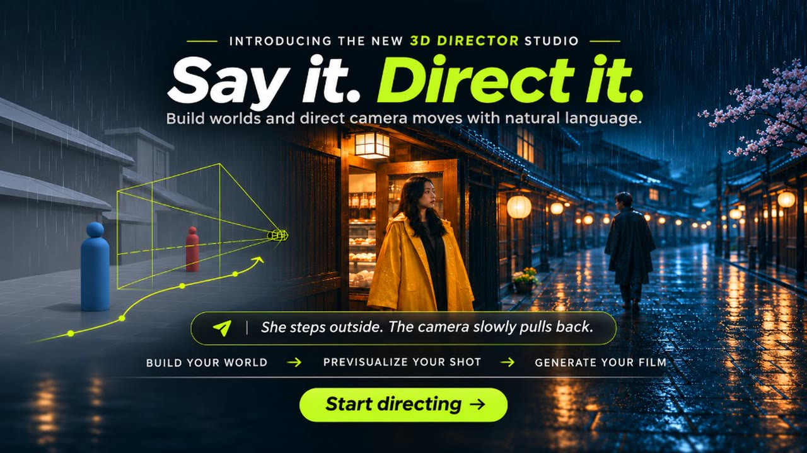

# Bloomway World Director

**Build a world. Block a scene. Rehearse the camera.**

Studio pravis 3D sumber terbuka untuk perancangan adegan, blok aksara, dan pergerakan kamera.

[English](README.md) · [中文](README.zh-CN.md) · [Indonesia](README.id.md) · [日本語](README.ja.md) · [한국어](README.ko.md) · [Español](README.es.md)

<p align="center">
  <a href="https://bloomway-ai.github.io/bloomway-world-director/watch-full-demo.html">
    
  </a>
  <br><sub><a href="https://bloomway-ai.github.io/bloomway-world-director/watch-full-demo.html">▶ Play</a> · 63s · <a href="https://github.com/bloomway-ai/bloomway-world-director/releases/download/v0.1.0/final_v2_cold_open.mp4">1080p</a></sub>
</p>

*File visi 63s — laluan produk Bloomway; bukan rakaman OSS Studio di bawah.*

Repositori ini menyediakan alat pravis 3D sumber terbuka. Penjanaan rakaman akhir ialah aliran kerja [Bloomway](https://bloomway.ai) yang berasingan.

**[Cuba dalam pelayar](https://bloomway-ai.github.io/bloomway-world-director/)** · [Run locally](#run-locally)

Percuma · MIT · tanpa pendaftaran (**OSS Studio sahaja**).

---

## Try it

**[Buka Studio dalam pelayar](https://bloomway-ai.github.io/bloomway-world-director/)** — praset / kata kunci / main garis masa. Bukan penjanaan NL terbuka.

### Run locally

```bash
git clone https://github.com/bloomway-ai/bloomway-world-director.git
cd bloomway-world-director && npm install && npm run dev
```

---

## See the open-source Studio in action

<p align="center"><a href="https://bloomway-ai.github.io/bloomway-world-director/"></a></p>
<p align="center"><a href="https://bloomway-ai.github.io/bloomway-world-director/?example=1&autoplay=1"></a></p>

<table>
  <tr>
    <td width="50%"><a href="https://github.com/bloomway-ai/bloomway-world-director/releases/download/v0.1.0/demo-city-tour.mp4"></a></td>
    <td width="50%"><a href="https://github.com/bloomway-ai/bloomway-world-director/releases/download/v0.1.0/demo-drama.mp4"></a></td>
  </tr>
</table>

[README.md](README.md) (penuh) · **info@bloomway.ai** · [MIT](LICENSE)