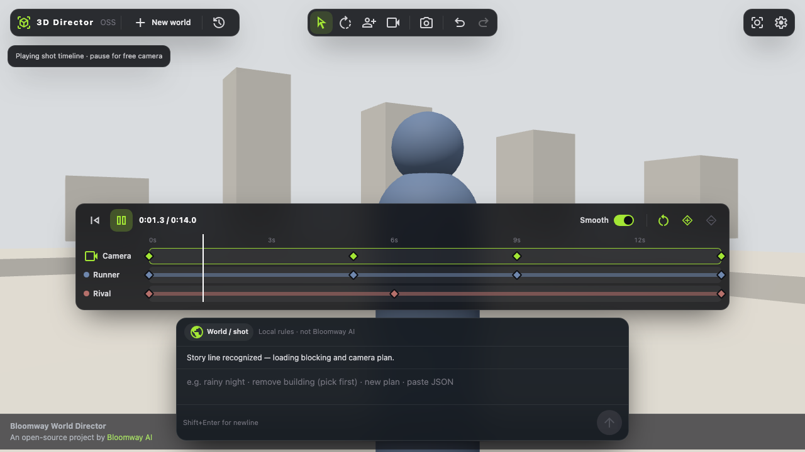
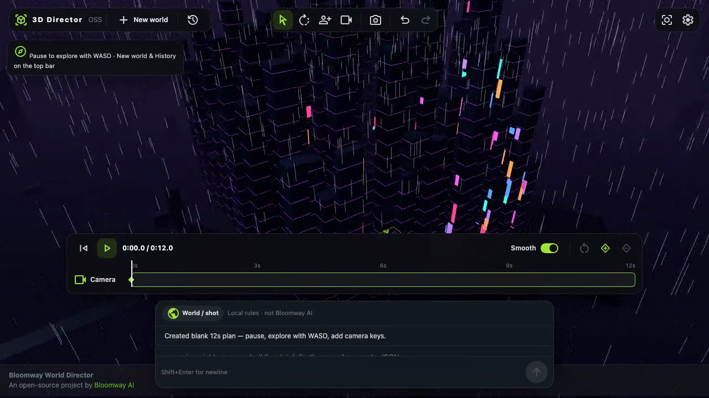
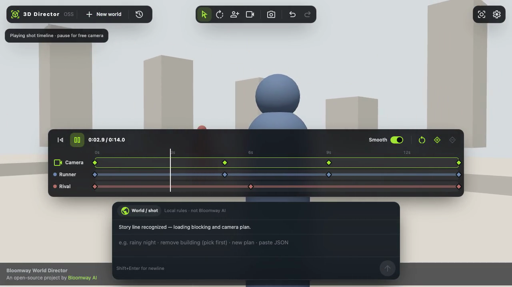

# Bloomway World Director

[English](README.en.md) · [中文](README.zh-CN.md) · [Melayu](README.ms.md) · [Indonesia](README.id.md) · [日本語](README.ja.md) · [한국어](README.ko.md) · [Español](README.es.md) · [**Semua bahasa**](README.md)

**Your words. Your world. Your camera.**

Bina dunia 3D dan arahkan pergerakan kamera untuk **pravisualisasi** sinematik (blok mesin poli rendah)—bukan model penjana video AI umum. Menukar pravis kepada rakaman siap ialah aliran kerja pilihan di [Bloomway](https://bloomway.ai).

> **Eksperimen terbuka Bloomway:** bina dunia daripada satu ayat, susun syot dalam pravis 3D, kemudian bawa ke skrin. Alat terbuka untuk pencipta dan penyelidik.  
> **Kemas kini berterusan:** repositori ini diselenggara secara aktif; jangkakan penambahbaikan berterusan.

**Penggunaan komersial MIT** tidak memerlukan pendaftaran, notifikasi, atau perkongsian hasil. Hubungi **info@bloomway.ai** hanya jika anda mahukan kerjasama—**bukan** syarat lesen. Lihat [docs/commercial-use.md](docs/commercial-use.md).

---

## Tiga laluan

| Laluan | Apa itu |
| ------ | ------- |
| **Laluan 1 — Sumber terbuka (tempatan)** | Jalankan contoh secara tempatan dan fahami teks → pravis 3D. Sesuai untuk pembelajaran, pengajaran, dan penyelidikan. |
| **Laluan 2 — Bloomway MCP (pilihan)** | Sambungkan perihalan yang sama kepada pravis dan penjanaan dihos—**pilihan**, tidak diperlukan untuk menggunakan repo ini. |
| **Laluan 3 — Lanjutan & pasukan** | Kerjasama, templat komersial, dan sokongan penghantaran di [platform Bloomway](https://bloomway.ai). |

Kongsi contoh syot anda dalam Discussions apabila tersedia.

---

## Mula pantas

**Keperluan:** Node.js ≥ 20, npm ≥ 10. Tiada akaun Bloomway atau kunci API untuk contoh terbundel.

```bash
git clone https://github.com/bloomway-ai/bloomway-world-director.git
cd bloomway-world-director
npm install
npm run verify:example
npm run dev                  # Studio di http://localhost:5173/
```

Studio lalai memuatkan [`examples/edo-rainy-night`](examples/edo-rainy-night/) (JSON dalam repo, bukan inferens awan langsung).

**Sumber kebenaran:** [docs/implementation-audit.md](docs/implementation-audit.md) · [docs/verification-log.md](docs/verification-log.md)

Pilihan: `npm run verify:studio-e2e`, `npm run record:demos`, `npm run capture:screenshots`.

---

## Tangkapan skrin

| Laman utama | Dunia satu baris | Garis masa kamera |
| ----------- | ---------------- | ----------------- |
|  |  |  |

---

## Lihat tindakan

Dirakam daripada Studio OSS **repositori ini** (bukan aplikasi komersial Bloomway penuh). Klik poster untuk membuka video.

<p align="center">
  <a href="media/demo-city-tour.mp4"></a>
  &nbsp;
  <a href="media/demo-drama.mp4"></a>
</p>

| Demo | Arahan satu baris | Fail |
| ---- | ----------------- | ---- |
| Lawatan bandar | `Snowy daytime Tokyo urban city` → teroka dengan WASD | [demo-city-tour.mp4](media/demo-city-tour.mp4) |
| Drama jalanan | `Rainy night — two rivals meet in the street` → main blok | [demo-drama.mp4](media/demo-drama.mp4) |

Jana semula: `npm run record:demos`. Legasi: [demo.mp4](media/demo.mp4) · [Nota media](media/README.md)

Produk penuh: [bloomway.ai](https://bloomway.ai)

---

## Apa yang berjalan secara tempatan

| Status | Keupayaan |
| ------ | --------- |
| **Disahkan** | `plan.json` + `world-ref.json`, `validatePrevisPlan`, `generatePrevisWorld`, `samplePrevisCamera` |
| **Disahkan** | Viewport Pengarah V2 + garis masa (`verify:studio-e2e`); blok legasi melalui `?legacy=1` |
| **Eksperimental** | Komposer kata kunci/peraturan tanpa LLM awan |
| **Dirancang** | Komposer awan penuh, alat MCP Director, lebih banyak contoh |

Pembantu bahasa semula jadi «ayat apa pun → pelan» hanya **dihoskan di Bloomway** (tiada dalam repo ini).

---

## Had semasa

1. Saluran pemasaran menerangkan visi produk; contoh OSS menggunakan **JSON yang disemak masuk**.  
2. Kesetiaan visual ialah **blok sahaja**—bukan render akhir Bloomway.  
3. **UI Studio bahasa Inggeris sahaja** dalam v0.1; lihat [docs/product-parity.md](docs/product-parity.md).  
4. «Satu baris → dunia» tempatan menggunakan **peraturan dan praset**, bukan NLU awan penuh.

Butiran: [docs/implementation-audit.md](docs/implementation-audit.md) §6.

---

## Peta jalan

- Lebih banyak contoh (`modern-city-street`, `mars-base`)
- Dokumentasi dan alat integrasi MCP
- Studio lebih kaya (import, eksport UI)
- Terjemahan UI Studio (krom aplikasi; README sudah berbilang bahasa)

---

## Aliran kerja Bloomway pilihan

*Mahu menukar pravis kepada rakaman siap? Terokai aliran kerja bersambung di [Bloomway](https://bloomway.ai).*

---

## Penggunaan komersial & penjenamaan

MIT — lihat [LICENSE](LICENSE). Hak cipta (c) 2026 Bloomway AI Inc. Media demo: [CC BY 4.0](media/README.md). Notis pihak ketiga: [docs/THIRD_PARTY_NOTICES.md](docs/THIRD_PARTY_NOTICES.md).

Tanda dagangan: [TRADEMARKS.md](TRADEMARKS.md). Jangan implikasikan sokongan rasmi.

---

## Menyumbang

[CONTRIBUTING.md](CONTRIBUTING.md) · [docs/ACCEPTANCE.md](docs/ACCEPTANCE.md)

*Jika ini membantu anda meneroka satu syot—atau anda ingin mengikuti apa yang kami bina seterusnya—berikan projek ini ⭐.*