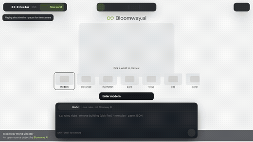

# Bloomway World Director

**搭建世界 · 调度场景 · 排练镜头**

开源三维预演 Studio：规划场景、人物站位与摄影机运动。

[English](README.md) · [Melayu](README.ms.md) · [Indonesia](README.id.md) · [日本語](README.ja.md) · [한국어](README.ko.md) · [Español](README.es.md)

<p align="center">
  <a href="https://bloomway-ai.github.io/bloomway-world-director/watch-full-demo.html">
    
  </a>
  <br><sub>
    <strong><a href="https://bloomway-ai.github.io/bloomway-world-director/watch-full-demo.html" style="color:#9AE234; text-decoration:none;">▶ 播放完整演示</a></strong>
    · 63 秒 · 含音频 · 1280p（约 8MB）
    · <a href="https://github.com/bloomway-ai/bloomway-world-director/releases/download/v0.1.0/final_v2_cold_open.mp4">下载 1080p 正本</a>
  </sub>
</p>

*63 秒愿景片展示 Bloomway 产品路径，非下方 OSS 白盒 Studio 录屏。*

本仓库提供开源三维预演工具，最终成片生成属于独立的 [Bloomway](https://bloomway.ai) 工作流。

<p align="center">
  <a href="https://bloomway-ai.github.io/bloomway-world-director/" style="font-weight:800; font-size:1.2em; color:#9AE234; text-decoration:none;"><strong>浏览器试玩</strong></a>
  &nbsp;·&nbsp;
  <a href="#本地运行"><strong>本地运行</strong></a>
</p>

免费使用 · MIT 许可 · 无需注册（**仅指 OSS Studio**，不包含云端成片算力）。

---

## 体验一下

### 浏览器试玩

<strong style="color:#9AE234;">浏览器试玩</strong> — <a href="https://bloomway-ai.github.io/bloomway-world-director/"><strong>打开在线 Studio</strong></a>

1. 或 [`?example=1&autoplay=1`](https://bloomway-ai.github.io/bloomway-world-director/?example=1&autoplay=1) 加载 Edo 示例。  
2. 选 **预设** 或在 **指令输入框** 输入短句（关键词规则，非任意自然语言生成）。  
3. 时间轴 **播放**，预览摄影机与站位。

无需注册或 API Key · 建议桌面浏览器 · 页脚 **GitHub** 返回本仓库。

### 本地运行

Node.js **≥ 20** · npm **≥ 10** · 默认示例无需 Bloomway 账号。

```bash
git clone https://github.com/bloomway-ai/bloomway-world-director.git
cd bloomway-world-director
npm install
npm run dev
```

**http://localhost:5173/** · 默认 [`examples/edo-rainy-night`](examples/edo-rainy-night/)。

---

## 开源 Studio 实拍

本仓库 OSS Studio 的真实录屏（低模白盒，非成片）。

<p align="center">
  <a href="https://bloomway-ai.github.io/bloomway-world-director/">
    
  </a>
</p>

<p align="center">
  <a href="https://bloomway-ai.github.io/bloomway-world-director/?example=1&autoplay=1">
    
  </a>
</p>

<table>
  <tr>
    <td width="50%"><a href="https://github.com/bloomway-ai/bloomway-world-director/releases/download/v0.1.0/demo-city-tour.mp4"></a></td>
    <td width="50%"><a href="https://github.com/bloomway-ai/bloomway-world-director/releases/download/v0.1.0/demo-drama.mp4"></a></td>
  </tr>
</table>

文案走**离线规则与预设**，非任意自然语言生成。完整 MP4：[Release v0.1.0](https://github.com/bloomway-ai/bloomway-world-director/releases/tag/v0.1.0)。

有帮助请点 ⭐。

---

## 能做什么

- 预设与 `world-ref.json` 搭建街景 / 城市场景  
- **人物站位**（胶囊体）与时间轴预览  
- **摄影机路径**与镜头节奏排练  
- JSON 或本地关键词短句编辑  

| 本仓库 OSS | 不包含 |
| ---------- | ------ |
| 低模白盒预演 | 通用 AI 成片 / 免费云端渲染 |
| 离线预设 + 关键词 | 托管 LLM「任意句子 → 方案」 |

[docs/implementation-audit.md](docs/implementation-audit.md) · [docs/commercial-use.md](docs/commercial-use.md) · [MIT](LICENSE)

---

## 示例场景

| 示例 | 说明 |
| ---- | ---- |
| [Edo 雨夜](examples/edo-rainy-night/) | 默认 `?example=1` |
| [街头剧情](examples/street-drama/) | 与上方演示配套 |
| 现代城市 / 火星 | [docs/examples/STATUS.md](docs/examples/STATUS.md) |

---

## 当前限制

白盒精度 · v0.1 Studio 英文界面 · 建议桌面 WebGL · 输入框为关键词规则，非云端 LLM。

---

## 社区与贡献

**[Discussions](https://github.com/bloomway-ai/bloomway-world-director/discussions)** · [CONTRIBUTING.md](CONTRIBUTING.md) · 可选 **info@bloomway.ai**

---

## 路线图

Director **MCP** 与 Studio 多语言：**计划中** — [docs/mcp/README.md](docs/mcp/README.md)

---

## 许可

[MIT](LICENSE) · 演示 [CC BY 4.0](media/LICENSE) · [TRADEMARKS.md](TRADEMARKS.md)

[](https://github.com/bloomway-ai/bloomway-world-director/actions/workflows/verify.yml)