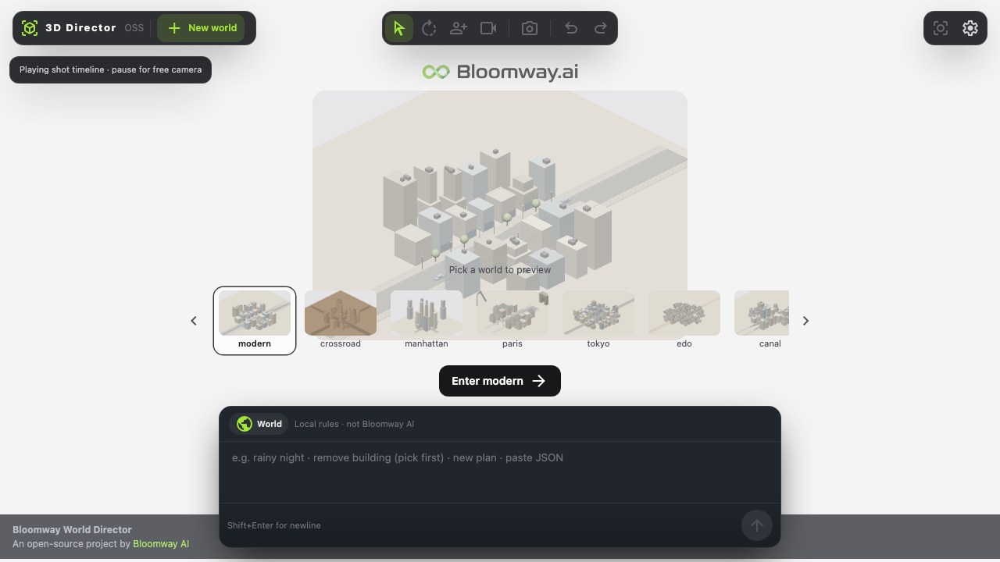

# Bloomway World Director

[English](README.en.md) · [中文](README.zh-CN.md) · [Melayu](README.ms.md) · [Indonesia](README.id.md) · [日本語](README.ja.md) · [한국어](README.ko.md) · [Español](README.es.md) · [**全部语言**](README.md)

**Your words. Your world. Your camera.**

用一句话搭建三维世界、调度人物与摄影机，完成电影**预演**（低模白盒）——本项目不是通用 AI 视频生成模型。成片生成属于 [Bloomway](https://bloomway.ai) 上的可选工作流。

> **Bloomway 开源实验：**用一句话搭建世界，在三维预演中安排人物与摄影机，再把镜头变成画面。面向创作者与研究者的开放工具。  
> **持续更新：**本仓库在积极维护中，功能与文档会不断更新。

按 **MIT** 可**免费商用**，无需注册、报备或作品分成。联系 **info@bloomway.ai** 仅用于自愿合作，**不是**使用条件。见 [docs/commercial-use.md](docs/commercial-use.md)。

---

## 三条路径

| 路径 | 说明 |
| ---- | ---- |
| **路径一 · 本地开源** | 在本地运行示例，理解「文字 → 三维预演」。适合学习、教学与研究。 |
| **路径二 · Bloomway MCP（可选）** | 用同一套描述连接托管预演与生成能力——**非运行本仓库所必需**。 |
| **路径三 · 进阶与团队** | 多人协作、商业模板与交付支持 → [Bloomway 平台](https://bloomway.ai)。 |

欢迎把镜头示例分享到 Discussions（上线后）。

---

## 快速开始

**环境：** Node.js ≥ 20，npm ≥ 10。捆绑示例**无需** Bloomway 账号或 API Key。

```bash
git clone https://github.com/bloomway-ai/bloomway-world-director.git
cd bloomway-world-director
npm install
npm run verify:example
npm run dev                  # http://localhost:5173/
```

默认加载 [`examples/edo-rainy-night`](examples/edo-rainy-night/)（仓库内 JSON，非云端推理）。

**实现边界：** [docs/implementation-audit.md](docs/implementation-audit.md) · [docs/verification-log.md](docs/verification-log.md)

可选：`npm run verify:studio-e2e`、`npm run record:demos`、`npm run capture:screenshots`。

---

## 界面截图

OSS Studio **v0.1**（界面仅英文）。首页 → 一句话建世界 → 运镜时间轴。

| 首页（预设与输入） | 一句话生成世界 | 运镜与时间轴 |
| ------------------ | -------------- | ------------ |
|  |  |  |

---

## 观看演示

录屏来自**本仓库** OSS Studio，非完整商业客户端。  
GitHub 首页**不会自动播放** mp4，请**点击海报**打开视频文件，或使用下表链接。

<p align="center">
  <a href="media/demo-city-tour.mp4"></a>
  &nbsp;
  <a href="media/demo-drama.mp4"></a>
</p>

| 演示 | 一句话 | 文件 |
| ---- | ------ | ---- |
| 城市巡游 | `Snowy daytime Tokyo urban city` → WASD 漫游 | [demo-city-tour.mp4](media/demo-city-tour.mp4) |
| 街头剧情 | `Rainy night — two rivals meet in the street` → 播放时间轴 | [demo-drama.mp4](media/demo-drama.mp4) |

重录：`npm run record:demos`。旧版：[demo.mp4](media/demo.mp4) · [media/README.md](media/README.md)

---

## 本地能力

| 状态 | 能力 |
| ---- | ---- |
| **已验证** | plan/world JSON、`validatePrevisPlan`、`generatePrevisWorld`、`samplePrevisCamera` |
| **已验证** | V2 视口与时间轴；`?legacy=1` 为旧版块 |
| **实验性** | 无云端 LLM 的规则 Composer |
| **计划中** | 完整 Composer、MCP、更多示例 |

「任意一句话 → 分镜」助手仅在 **Bloomway 托管侧**。

---

## 当前限制

1. 愿景文案与 OSS 示例（**JSON 驱动**）可能不一致。  
2. 画面为**白盒**，非 Bloomway 成片画质。  
3. Studio **界面 v0.1 仅英文**；见 [docs/product-parity.md](docs/product-parity.md)。  
4. 本地「一句话建城」为**规则与预设**，非完整云端自然语言理解。

详见 [docs/implementation-audit.md](docs/implementation-audit.md) 第 6 节。

---

## 示例场景

| 示例 | 目录 |
| ---- | ---- |
| 江户雨夜（Studio 默认） | [`examples/edo-rainy-night`](examples/edo-rainy-night/) |
| 街头对峙 | [`examples/street-drama`](examples/street-drama/) |
| 现代城市街道 | [`examples/modern-city-street`](examples/modern-city-street/) |
| 火星基地 | [`examples/mars-base`](examples/mars-base/) |

社区陈列：[`docs/gallery/README.md`](docs/gallery/README.md) · Discussions（开启后）。

## 路线图
- MCP 文档与工具
- Studio 导入/导出
- 应用界面多语言（README 已七语）

---

## 可选 Bloomway 工作流

*想把预演变成成片？在 [Bloomway](https://bloomway.ai) 了解连接工作流。*

---

## 商业使用与品牌

MIT — [LICENSE](LICENSE)。版权 (c) 2026 Bloomway AI Inc。演示媒体：[CC BY 4.0](media/README.md)。

商标：[TRADEMARKS.md](TRADEMARKS.md)。勿暗示官方背书。

---

## 贡献

[CONTRIBUTING.md](CONTRIBUTING.md) · [docs/ACCEPTANCE.md](docs/ACCEPTANCE.md)

*如果这个仓库帮你探索了一个镜头，或你想关注后续更新，欢迎点 ⭐。*