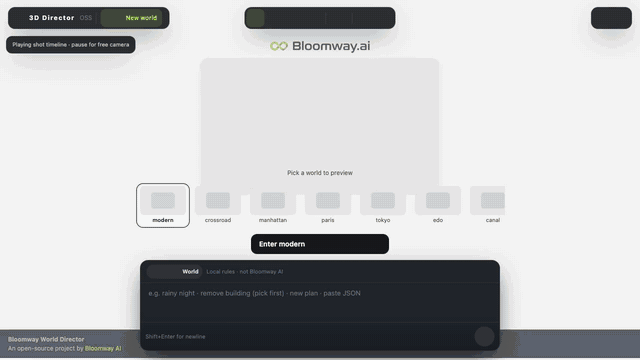
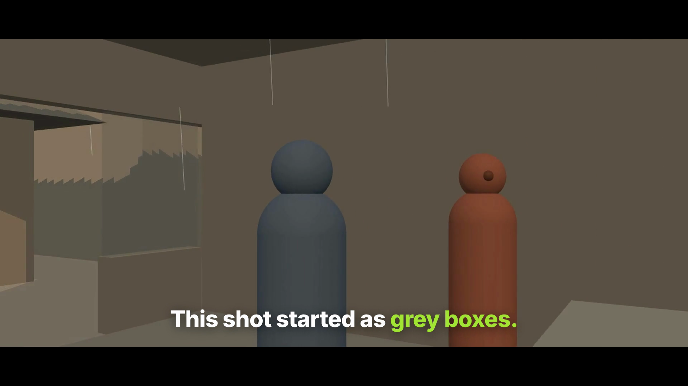

# Bloomway World Director

**搭建世界 · 调度场景 · 排练镜头**

开源三维预演 Studio：场景、人物站位与摄影机运动。

免费使用 · MIT 许可 · 无需注册

[English](README.md) · [Melayu](README.ms.md) · [Indonesia](README.id.md) · [日本語](README.ja.md) · [한국어](README.ko.md) · [Español](README.es.md)

**[浏览器试玩](https://bloomway-ai.github.io/bloomway-world-director/)** · [本地运行](#本地运行) · [观看演示](#观看演示)

无需注册或 API Key。建议使用桌面浏览器。

<p align="center">
  <a href="https://bloomway-ai.github.io/bloomway-world-director/?example=1&autoplay=1">
    
  </a>
  <br><sub>输入 → 白盒场景 → 时间轴 <strong>播放</strong>（街头剧情演示）</sub>
</p>

---

## 体验一下

### 浏览器试玩

<p align="center">
  <a href="https://bloomway-ai.github.io/bloomway-world-director/">
    
  </a>
</p>

**[打开在线 Studio](https://bloomway-ai.github.io/bloomway-world-director/)**

1. 打开链接，或 [`?example=1&autoplay=1`](https://bloomway-ai.github.io/bloomway-world-director/?example=1&autoplay=1) 从 Edo 示例开始。  
2. 选 **预设** 或在 **指令输入框** 输入短句。  
3. 时间轴点 **播放**，预览摄影机与站位。

页脚 **GitHub** 可返回本仓库。

### 本地运行

Node.js **≥ 20** · npm **≥ 10** · 无需账号

```bash
git clone https://github.com/bloomway-ai/bloomway-world-director.git
cd bloomway-world-director
npm install
npm run dev
```

打开 **http://localhost:5173/**。

---

## 观看演示

<table>
  <tr>
    <td width="50%"></td>
    <td width="50%"></td>
  </tr>
</table>

欢迎点 ⭐。边界说明：[docs/implementation-audit.md](docs/implementation-audit.md)。

---

## 从预演到成片

<p align="center">
  <a href="https://github.com/bloomway-ai/bloomway-world-director/releases/download/v0.1.0/final_v2_cold_open.mp4">
    
  </a>
  <br><sub><a href="https://github.com/bloomway-ai/bloomway-world-director/releases/download/v0.1.0/final_v2_cold_open.mp4">▶ 观看完整品牌片</a></sub>
</p>

---

## 社区

**在 [Discussions](https://github.com/bloomway-ai/bloomway-world-director/discussions) 分享你的第一个镜头。** · **info@bloomway.ai**（自愿合作）

[MIT](LICENSE) · 演示 [CC BY 4.0](media/LICENSE)